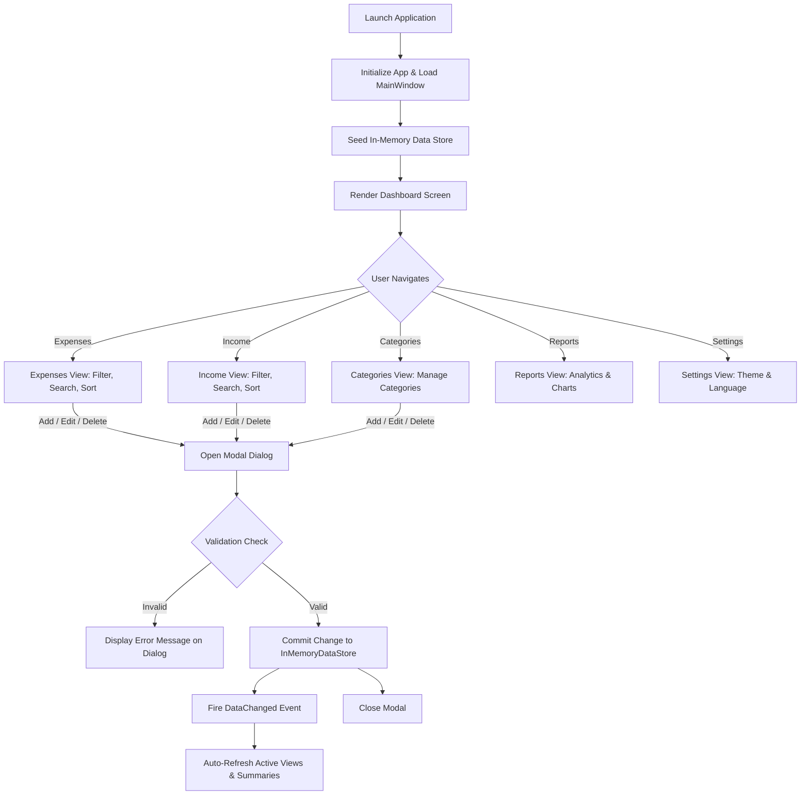
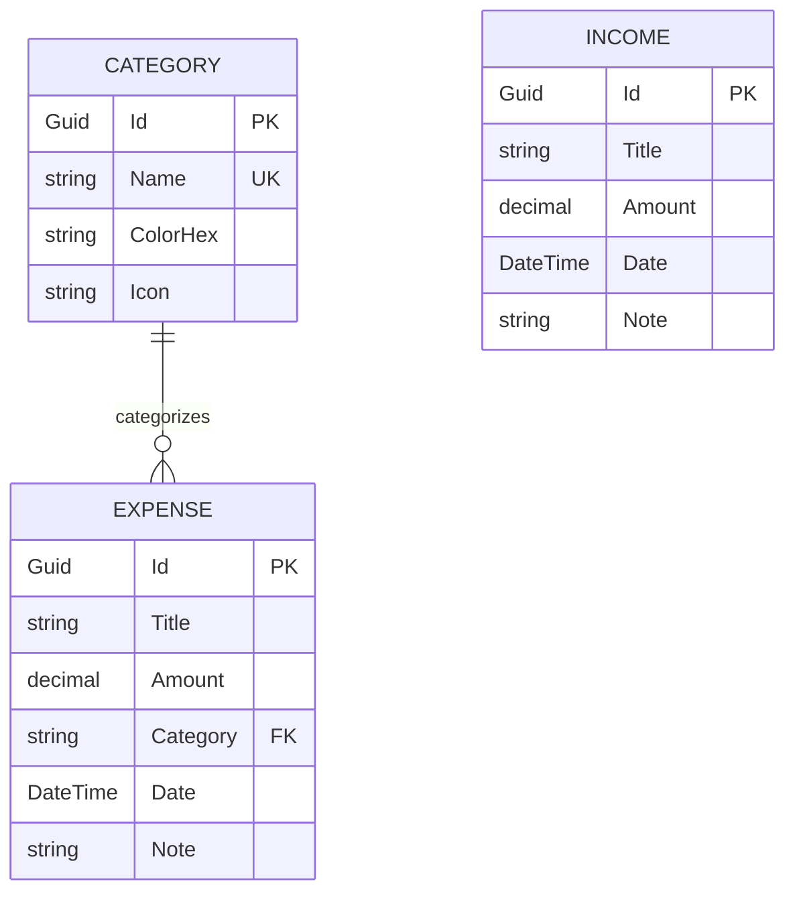

# Avilonia.ExpenseTracker

A modern, cross-platform personal finance desktop application built with **.NET 8** and **Avalonia UI**. Avilonia.ExpenseTracker provides real-time income and expense tracking, category budget analysis, interactive financial reporting, custom theme switching, and native bilingual localization (Myanmar & English).

---

## Table of Contents

- [Project Overview](#project-overview)
- [Technical Stack](#technical-stack)
- [Architecture](#architecture)
- [Overall Functional Flow](#overall-functional-flow)
- [Main Features](#main-features)
- [Project Structure](#project-structure)
- [Data Storage & Domain Model](#data-storage--domain-model)
- [Getting Started](#getting-started)
- [Environment Variables](#environment-variables)
- [Development Notes](#development-notes)

---

## Project Overview

**Avilonia.ExpenseTracker** is a personal finance management desktop application designed to help individuals monitor income, log day-to-day expenditures, organize expenses by categories, and analyze cash flow.

- **Problem It Solves**: Simplifies daily money management by eliminating cumbersome spreadsheets. Provides instant visual feedback on net monthly savings, expense distribution, and category trends without requiring complex setups or external database dependencies.
- **Target Users**: Individual users looking for a clean, responsive, localized personal accounting desktop tool.
- **Core Purpose**: Deliver a desktop accounting experience with dual-language support (Myanmar Burmese as default, English optional), dark/light theme options, and data validation rules.

---

## Technical Stack

| Technology | Version | Purpose in this Project |
| :--- | :--- | :--- |
| **C# / .NET** | `net8.0` | Primary programming language and runtime platform (`WinExe`). |
| **Avalonia UI** | `12.1.2` | Cross-platform XAML GUI framework powering the user interface and desktop windowing. |
| **Avalonia.Desktop** | `12.1.2` | Native desktop lifetime and OS platform integration (`StartWithClassicDesktopLifetime`). |
| **Avalonia.Themes.Fluent** | `12.1.2` | Fluent Design styling system with dynamic `Light` and `Dark` theme variants. |
| **Avalonia.Fonts.Inter** | `12.1.2` | Modern embedded typography across all application views. |
| **AvaloniaUI.DiagnosticsSupport** | `2.2.3` | Developer diagnostic and visual tree inspection tools in Debug builds. |
| **CommunityToolkit.Mvvm** | `8.4.2` | MVVM framework utilizing Roslyn source generators (`[ObservableProperty]`, `[RelayCommand]`, `ObservableObject`). |
| **In-Memory Data Store** | Custom | Event-driven reactive in-memory repository implementing `IInMemoryDataStore`. |
| **Localization Engine** | Custom | Dynamic dictionary-based service (`ILocalizationService`) supporting runtime language switching. |

---

## Architecture

The project follows the standard **Model-View-ViewModel (MVVM)** architectural pattern:

```text
┌────────────────────────────────────────────────────────┐
│                      Views (XAML)                      │
│     MainWindow, DashboardView, ExpensesView, etc.      │
└───────────────────────────▲────────────────────────────┘
                            │ Data Binding & Commands
┌───────────────────────────▼────────────────────────────┐
│                  ViewModels (C# MVVM)                  │
│       MainViewModel, DashboardViewModel, etc.          │
└───────────────────────────▲────────────────────────────┘
                            │ Service Invocation & Events
┌───────────────────────────▼────────────────────────────┐
│                     Services Layer                     │
│  IInMemoryDataStore  │  ILocalizationService  │ Theme  │
└───────────────────────────▲────────────────────────────┘
                            │ Domain Entities
┌───────────────────────────▼────────────────────────────┐
│                      Models Layer                      │
│         Expense  │  Income  │  Category  │  Enums      │
└────────────────────────────────────────────────────────┘
```

### Key Architectural Components

1. **ViewLocator (`ViewLocator.cs`)**: Maps ViewModels directly to Views using Avalonia's `IDataTemplate` convention (`ViewModel` &rarr; `View`).
2. **MainViewModel Host (`MainViewModel.cs`)**: Acts as the root navigation controller, holding instances of sub-viewmodels and managing the active modal overlay (`ActiveModal`, `IsModalOpen`).
3. **Reactive In-Memory Store (`InMemoryDataStore.cs`)**: Centralized repository implementing `IInMemoryDataStore`. Raises a `DataChanged` event whenever an entity is added, updated, or removed to keep all views synchronized.
4. **Value Converters (`Common/Converters/Converters.cs`)**: Handles UI presentation formatting, including `MmkCurrencyConverter` (e.g., `85,000 MMK`), `AppDateFormatConverter` (`dd-MM-yyyy`), `CategoryColorConverter`, and `CategoryDisplayConverter`.

---

## Overall Functional Flow

The following diagram illustrates how user actions flow through the application:



---

## Main Features

### 1. Dashboard
- **Financial Summary Cards**: Real-time totals for Income, Expenses, Current Net Balance, and Total Expense Count.
- **Current Month Overview**: Tracks current month income, expenses, and net savings.
- **Expense by Category Breakdown**: Visual progress bars representing each category's proportional spending.
- **Recent Transactions**: Lists recent expenditures and incomes with category badges and formatted dates.

### 2. Expense Management
- **CRUD Operations**: Record new expenses or edit/delete existing records.
- **Multi-criteria Filtering**: Live search by title, note, or category name; filter by specific category; filter by date range (`From Date` to `To Date`).
- **Sorting**: Sort by Newest First, Oldest First, Highest Amount, or Lowest Amount.
- **Live Summary**: Real-time calculated sum of currently filtered records.

### 3. Income Management
- **CRUD Operations**: Record salary, freelance payouts, or other revenue streams.
- **Filtering & Sorting**: Keyword search and date-range filtering with live filtered total amount.
- **Confirmation Guards**: Modal prompts before permanent deletion.

### 4. Category Management
- **Custom Categories**: Create and edit categories with custom color codes and icon representations.
- **Referential Integrity**: Prevents deletion of any category currently linked to existing expenses, showing a clear warning with active usage count.
- **Cascading Name Updates**: Renaming a category automatically updates all associated expense records.
- **Duplicate Prevention**: Rejects duplicate category names (case-insensitive).

### 5. Financial Reports & Analytics
- **KPI Metrics**: Displays average expense per transaction, total transaction count, and highlights the single highest expense.
- **Category Spending Distribution**: Calculates percentage share and amount per category.
- **Recent Spending Log**: Quick access to recent transaction history.

### 6. Settings & Customization
- **Theme Selection**: Seamlessly toggle between **Light Mode** and **Dark Mode** via Avalonia's fluent theme engine.
- **Bilingual Localization**: Switch between **Myanmar (Burmese - Default)** and **English** with real-time UI updates across all headers, inputs, dialogs, and messages.

---

## Project Structure

```text
Avilonia.ExpenseTracker/
├── Avilonia.ExpenseTracker.slnx             # Solution configuration file
└── Avilonia.ExpenseTracker/                 # Main project directory
    ├── Avilonia.ExpenseTracker.csproj       # Project file (.NET 8, Avalonia 12.1.2)
    ├── Program.cs                           # App entry point & AppBuilder configuration
    ├── App.axaml / App.axaml.cs             # Application styles, themes, and resources
    ├── ViewLocator.cs                       # MVVM ViewLocator resolving Views from ViewModels
    ├── Assets/                              # Static media assets (icons, brand marks)
    ├── Common/
    │   ├── Converters/
    │   │   └── Converters.cs                # Value converters (Currency, Date, Colors, Icons)
    │   ├── Models/
    │   │   ├── Category.cs                  # Category entity model
    │   │   ├── Expense.cs                   # Expense entity model
    │   │   ├── Income.cs                    # Income entity model
    │   │   ├── Enums.cs                     # AppLanguage, AppTheme, TransactionSortOrder
    │   │   └── SortOptionItem.cs            # Helper model for sort dropdowns
    │   └── Services/
    │       ├── IInMemoryDataStore.cs        # Data store interface
    │       ├── InMemoryDataStore.cs         # In-memory repository with seed data
    │       ├── ILocalizationService.cs      # Localization service interface
    │       ├── LocalizationService.cs       # Bilingual dictionary & translation engine
    │       └── ThemeService.cs              # Fluent theme switching service
    ├── Features/
    │   ├── Dashboard/                       # Dashboard View, ViewModel & summary models
    │   ├── Expenses/                        # Expense list, filters, and Add/Edit dialogs
    │   ├── Income/                          # Income list, filters, and Add/Edit dialogs
    │   ├── Categories/                      # Category cards, color picker, and dialogs
    │   ├── Reports/                         # Analytics and financial reports
    │   ├── Settings/                        # Language and theme selection view
    │   └── Shared/                          # Reusable ConfirmDialog and MessageDialog views
    ├── ViewModels/
    │   ├── ViewModelBase.cs                 # Base observable ViewModel with localization bindings
    │   └── MainViewModel.cs                 # Root navigation and modal state manager
    └── Views/
        └── MainWindow.axaml / .cs           # Shell layout with responsive navigation & dialog overlay
```

---

## Data Storage & Domain Model

The application uses an in-memory data store (`InMemoryDataStore`) implementing `IInMemoryDataStore`.

### Entity Relationship Diagram



### Data Integrity Rules
- **Category Uniqueness**: Category names must be unique (checked case-insensitively).
- **Referential Protection**: A category cannot be deleted if referenced by one or more expenses.
- **Cascading Name Sync**: Updating a category's name propagates to all expenses assigned to that category.
- **Positive Amounts**: Both income and expense amounts must be strictly greater than `0 MMK`.
- **Validation**: Mandatory fields (`Title`, `Amount`, `Category`, `Date`) are enforced before persistence.

---

## Getting Started

### Prerequisites

- [.NET 8.0 SDK](https://dotnet.microsoft.com/download/dotnet/8.0) or higher.
- A supported operating system (Windows 10/11, macOS, or Linux).
- Optional IDE: Visual Studio 2022 (v17.8+), JetBrains Rider, or VS Code with the [Avalonia extension](https://marketplace.visualstudio.com/items?itemName=AvaloniaTeam.vscode-avalonia).

### Installation & Run

1. **Clone or open the repository**:
   ```bash
   git clone https://github.com/theinhtetaung-dev/Avilonia.ExpenseTracker.git
   cd Avilonia.ExpenseTracker
   ```

2. **Restore dependencies**:
   ```bash
   dotnet restore
   ```

3. **Build the application**:
   ```bash
   dotnet build
   ```

4. **Run the application**:
   ```bash
   dotnet run --project Avilonia.ExpenseTracker/Avilonia.ExpenseTracker.csproj
   ```

---

## Environment Variables

This application is fully self-contained and operates purely with local in-memory storage.

- **No external environment variables or configuration files are required.**
- **No external database connection strings, cloud API keys, or credentials are needed.**

All sample data is seeded automatically in memory upon startup.

---

## Development Notes

- **Default Language**: The application starts in **Myanmar (Burmese)** by default. To switch to English, navigate to `Settings` (`ဆက်တင်များ`) and select **English**.
- **Date Format Standard**: All dates throughout the application strictly follow the `dd-MM-yyyy` standard (e.g., `20-10-2026`).
- **Currency Standard**: All monetary values are calculated in **MMK** (Myanmar Kyat) and formatted using standard thousand separators (e.g., `1,800,000 MMK`).
- **MVVM Source Generators**: When adding new properties or commands in ViewModels, use CommunityToolkit.Mvvm attributes (`[ObservableProperty]`, `[RelayCommand]`) on `partial class` definitions.
- **Dialog System**: Modals are displayed via `MainViewModel.Instance.OpenModal(...)` and bound to the overlay container in `MainWindow.axaml`. Avoid creating secondary OS windows to maintain consistent cross-platform behavior.
